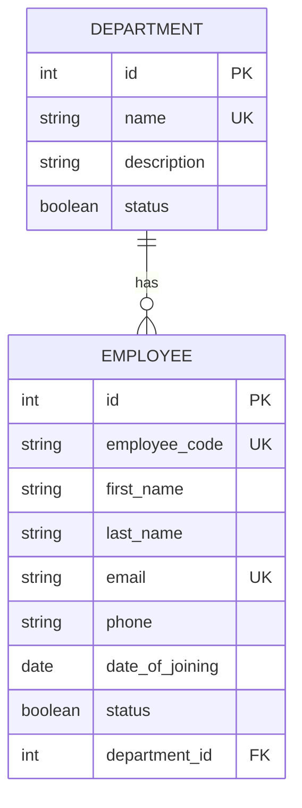

# Day 1 - Resource Models and API Contracts

**Date:** 19 October 2026
**Project:** HRMS Backend
**Technologies:** Django, Django REST Framework, PostgreSQL

## 1. Objective

Review the Employee and Department models, document their relationship, define the API contracts, and verify serializer validation and error handling through tests.

## 2. Model Relationship

A Department can have multiple Employees. Each Employee belongs to one Department through a foreign key.



### Model rules

- Department names are unique.
- Employee codes and email addresses are unique.
- Employee records reference a Department.
- Employees use `on_delete=PROTECT` for their Department relationship.
- A Department with assigned Employees must not be deleted.
- Employee deletion follows business rules; active Employees cannot be deleted.
- The Employee model uses `related_name="employees"` to access its related Employees.

## 3. Employee API Contract

Base URL: `/api/employees/`

| Method | Endpoint | Purpose |
|---|---|---|
| GET | `/api/employees/` | List Employees |
| POST | `/api/employees/` | Create an Employee |
| GET | `/api/employees/<id>/` | Retrieve an Employee |
| PUT | `/api/employees/<id>/` | Replace/update an Employee |
| PATCH | `/api/employees/<id>/` | Partially update an Employee |
| POST | `/api/employees/<id>/` | Perform the supported action, such as deactivation |
| DELETE | `/api/employees/<id>/` | Delete an eligible Employee |

### List query parameters

- `search`: Search supported Employee fields.
- `status`: Filter by active or inactive status.
- `department`: Filter by Department ID.
- `include_inactive=true`: Include inactive Employees.
- `page`: Select a result page, subject to the configured pagination behavior.

Invalid status or Department filter values should return a validation error.

### Example create request

```json
{
  "employee_code": "EMP003",
  "first_name": "Ravi",
  "last_name": "Kumar",
  "email": "ravi@example.com",
  "phone": "9876543210",
  "date_of_joining": "2026-10-19",
  "status": true,
  "department": 1
}
```

The Department ID must refer to a valid, eligible Department.

### Employee validation

The Employee serializer handles input validation, including:

- Trimming whitespace from supported text fields.
- Normalizing email addresses to lowercase.
- Checking duplicate employee codes and email addresses.
- Rejecting an inactive Department.
- Returning field-level validation errors for invalid input.

The service layer uses transactions and model validation to protect business operations.

## 4. Department API Contract

Base URL: `/api/departments/`

| Method | Endpoint | Purpose |
|---|---|---|
| GET | `/api/departments/` | List Departments |
| POST | `/api/departments/` | Create a Department |
| GET | `/api/departments/<id>/` | Retrieve a Department |
| PUT | `/api/departments/<id>/` | Update a Department |
| PATCH | `/api/departments/<id>/` | Partially update a Department |
| DELETE | `/api/departments/<id>/` | Delete a Department when permitted |

### Department validation and pagination

- Department names are trimmed.
- Empty names are rejected.
- Duplicate names are rejected without preventing a Department from retaining its existing name during an update.
- Name uniqueness is checked without regard to letter case.
- Department list filtering supports `search` and `status`.
- Department pagination uses a default page size of 10 and a maximum page size of 100.

## 5. Response and Error Contracts

Successful API responses use a consistent structure where implemented:

```json
{
  "success": true,
  "message": "Operation completed successfully.",
  "data": {}
}
```

Validation failures use a structured response:

```json
{
  "success": false,
  "message": "Validation failed.",
  "details": {
    "field": ["Explanation of the validation error."]
  }
}
```

The exact message and details depend on the endpoint and error.

Important negative cases include:

- Duplicate Employee code or email.
- Duplicate or blank Department name.
- Invalid Department ID or filter value.
- Updating an Employee with invalid data.
- Retrieving a nonexistent record.
- Deleting an active Employee.
- Deleting a Department that still has Employees.

## 6. Testing and Verification

Commands used during Day 1:

```powershell
python manage.py check
python -m py_compile apps\employees\models.py apps\employees\serializers.py apps\departments\serializers.py
python manage.py test apps.employees apps.departments -v 2
```

Previously observed results:

- Django system check passed.
- Python compilation checks passed.
- The Employee and Department test suite passed all 29 tests.
- Three targeted Department update and duplicate-name tests passed.

Run the full test suite again before committing to confirm the current code still passes.

## 7. Design Decisions

- **Foreign key:** Represents the many-to-one Employee-to-Department relationship.
- **Unique constraints:** Protect unique business identifiers.
- **Serializer validation:** Rejects invalid API input before normal processing.
- **Service layer:** Centralizes Employee business rules and transactional operations.
- **Pagination:** Limits the amount of list data returned in one response.
- **Structured errors:** Help API clients understand unsuccessful requests.
- **Automated tests:** Check successful behavior and negative cases.

## 8. Remaining Verification

- Confirm the Department deletion response uses HTTP 409 when deletion is blocked by assigned Employees.
- Review boundary tests for phone length and blank or case-insensitive duplicate Department names.
- Confirm the exact Employee pagination response and configured defaults.
- Keep database passwords and other secrets out of source files and Git commits.

## 9. Day 1 Outcome

The model relationship, endpoint methods, validation rules, response conventions, and important negative cases have been documented. Final completion requires verifying the saved documentation, rerunning the checks, reviewing the Git diff, and committing and pushing the changes.
